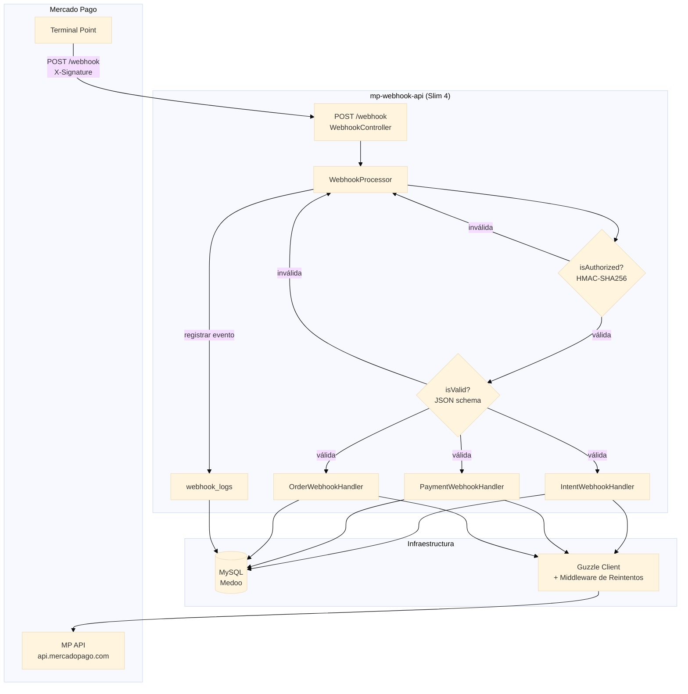
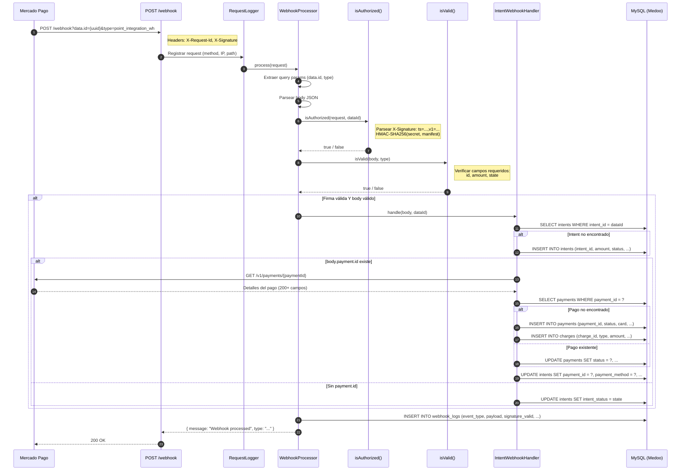
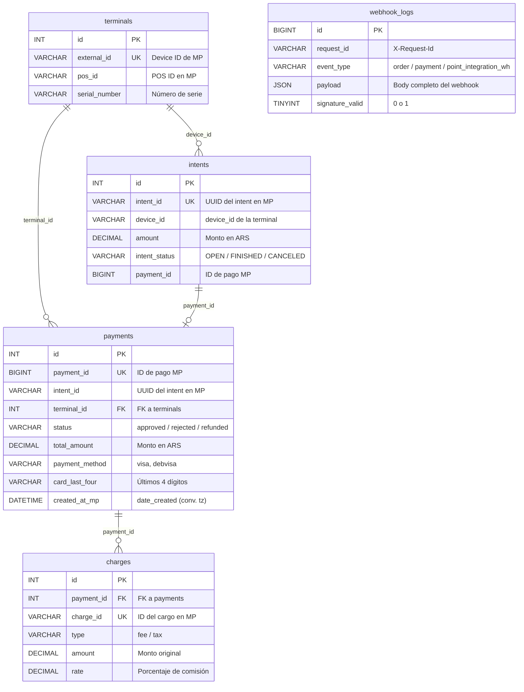

# mp-webhook-api

Procesador de webhooks de Mercado Pago construido con Slim 4. Recibe, valida, registra y almacena notificaciones de pago desde terminales presenciales _Point Smart_, y también compatible con pagos desde QR estáticos. Pensado como el puente entre MP y el software POS de una tienda física.

Para comprender este proyecto, se recomienda fuertemente repasar la documentación de Mercado Pago:
https://www.mercadopago.com.ar/developers/es/docs/mp-point/overview

> **Nota:** Este proyecto es una refactorización asistida por IA a partir de un desarrollo real sobre la API MP legacy, supervisado por mí. Puede revisar el [PLAN.md](./docs/PLAN.md) con las decisiones de implementación.

## Instalación

### Prerrequisitos

- PHP 8.3+ con extensiones `pdo_mysql`, `json`, `mbstring`, `openssl`
- MariaDB 10.6+ o MySQL 8.0+ (para compatibilidad con columnas `json`, sino ajustar tabla `webhook_logs`)
- Composer 2.x

### Pasos

```bash
git clone https://github.com/Arian023/mp-webhook-api.git
cd mp-webhook-api
composer install
cp .env.example .env
```

Editar `.env` con tus credenciales:

```env
DB_HOST=localhost
DB_PORT=3306
DB_NAME=mp_webhook
DB_USER=root
DB_PASS=

MP_ACCESS_TOKEN=APP_USR-...
MP_WEBHOOK_SECRET=tu-webhook-secret
```

## Stack Tecnológico

- [**PHP**](https://www.php.net/) 8.3 en adelante
- [**Slim 4**](https://www.slimframework.com/) — Micro framework PSR-7/15
- [**PHP-DI**](https://php-di.org/doc/frameworks/slim.html) — Contenedor de inyección de dependencias
- [**Medoo**](https://medoo.in/) — Abstracción de base de datos ligera, basada en PDO.
- [**Guzzle 7**](https://docs.guzzlephp.org/en/stable/index.html) — Cliente HTTP con middleware de reintentos
- [**Monolog 3**](https://seldaek.github.io/monolog/) — Logging a archivos, consola o base de datos
- [**Phinx**](https://phinx.org/) — Migraciones de base de datos
- [**Carbon**](https://carbon.nesbot.com/) — Manejo de fechas

## Desarrollo

Este proyecto incluye configuración para [Lerd](https://lerd.sh). Iniciar con:

```bash
lerd link          # Registrar sitio en mp-webhook-api.test
lerd start         # Iniciar PHP-FPM, MariaDB, Nginx
```

MariaDB está disponible en `lerd-mariadb-11-8:3306` desde los contenedores (usuario: `root`, contraseña: `lerd`).

Alternativamente, se puede usar [php.new](https://php.new/) o [Laravel Herd](https://herd.laravel.com/) en Windows / MacOS para correr el proyecto rápidamente.

```bash
# Estilo de código (Pint)
composer lint

# Análisis estático (PHPStan nivel 5)
composer analyse

# Ambos
composer test
```

### Base de datos

```bash
# Crear la base de datos
mysql -u root -p -e "CREATE DATABASE mp_webhook CHARACTER SET utf8mb4;"

# Ejecutar migraciones
vendor/bin/phinx migrate
```

---


## Arquitectura

Este esquema representa el flujo de procesamiento de una notificación webhook recibida, hasta ser almacenada en la base de datos. Un webhook solamente provee los datos mínimos de un intent, pago u orden. Para obtener la información completa, se realizan llamadas a la API de Mercado Pago.



### Capas

| Capa | Ruta | Descripción                                 |
|---|---|---------------------------------------------|
| HTTP | `app/Http/Controllers/` | Manejo de rutas Slim                        |
| Middleware | `app/Http/Middleware/` | Auth, logging, manejo de errores            |
| Aplicación | `app/Application/Services/` | Orquestación de lógica de negocio           |
| Infraestructura | `app/Infrastructure/` | Base de datos, cliente MP API, repositorios |

---

## Endpoints de la API

### Webhook (sin auth — firma validada)

```
POST /webhook?data.id={uuid}&type=point_integration_wh
```

Headers: `X-Request-Id`, `X-Signature: ts=...,v1=...`

### Gestión de Intents (Bearer auth)

| Método | Endpoint | Descripción |
|---|---|---|
| `POST` | `/api/intents?device_id={id}` | Crear intent de pago |
| `GET` | `/api/intents/{id}` | Obtener estado del intent |
| `DELETE` | `/api/intents/{id}/cancel?device_id={id}` | Cancelar intent |
| `POST` | `/api/intents/{id}/refund` | Reembolsar pago del intent |

### Gestión de Pagos (Bearer auth)

| Método | Endpoint | Descripción |
|---|---|---|
| `GET` | `/api/payments/{id}` | Obtener detalles del pago |
| `POST` | `/api/payments/{id}/refund` | Reembolsar pago |

### Orders API (Bearer auth)

| Método | Endpoint | Descripción |
|---|---|---|
| `POST` | `/api/orders` | Crear orden ( Orders API) |
| `GET` | `/api/orders/{id}` | Obtener detalles de la orden |
| `POST` | `/api/orders/{id}/cancel` | Cancelar orden |
| `POST` | `/api/orders/{id}/refund` | Reembolsar orden |

### Health (sin auth)

```
GET /health
```

Retorna `{"status":"ok","database":"connected"}`.

### Ejemplos de API

Ver `docs/examples/` para respuestas JSON anonimizadas de la API de Mercado Pago. Útiles como referencia para las estructuras de webhook y pago.

## Flujo del Webhook

### `point_integration_wh` (notificación de intent)

Se recibe cuando una terminal Point crea, completa o cancela un intent de pago.



```json
// Query: ?data.id=61ec4adf-...&type=point_integration_wh
// Body (state=FINISHED, tiene pago):
{
  "additional_info": {"external_reference": "000910854661-000910029286"},
  "amount": 3980000,
  "created_at": "2026-06-28 20:39:45",
  "id": "61ec4adf-82b3-414e-beb7-0308f131c63b",
  "payment": {"id": 165404232933, "state": "approved", "type": "credit_card"},
  "state": "FINISHED"
}
```

**Clave**: `amount` está en **centavos** (dividir por 100 para ARS).

Pasos de procesamiento:
1. Validar firma HMAC-SHA256
2. Buscar o crear intent en tabla `intents`
3. Si existe `payment.id` → obtener pago completo de `GET /v1/payments/{id}`
4. Insertar pago + cargos en la DB
5. Vincular intent al pago
6. Registrar evento en `webhook_logs`

### `payment` (API legacy)

Notificación directa de pago. Obtiene los detalles del pago y los almacena.

### `order` (API actual)

Notificación de estado de orden. Recibe eventos de orden como `order.created`, `order.updated`, `order.canceled`. Obtiene la orden completa de MP API, almacena/actualiza en la DB local y sincroniza los pagos asociados.

### Notificaciones opcionales

Otros [casos opcionales](https://www.mercadopago.com.ar/developers/es/docs/mp-point/optional-notifications), como Vinculación de aplicaciones (`mp-connect`), Reclamos (`topic_claims_integration_wh`) y Contracargos (`topic_chargebacks_wh`), son registrados en `webhook_logs` y respondidos con HTTP 200 pero no se procesan. No son parte del scope del proyecto, y depende de su uso en un CRM o sistema de pagos.

## Esquema de Base de Datos

Seis tablas gestionadas por migraciones Phinx:

| Tabla | Descripción |
|---|---|
| `terminals` | Terminales Point registradas (external_id, pos_id, sucursal) |
| `intents` | Intents de pago (intent_id UUID, monto, estado, pago vinculado) |
| `payments` | Registros de pago (payment_id, datos de tarjeta, montos, timestamps) |
| `charges` | Desglose de comisiones e impuestos por pago |
| `orders` | Registros de Orders API (order_id, estado, device_id, detalles de pago) |
| `webhook_logs` | Log completo de eventos webhook (payload, firma, código de respuesta) |



## Estructura del Proyecto

```
mp-webhook-api/
├── app/
│   ├── Application/Services/        # WebhookProcessor, handlers, IntentService, PaymentService
│   ├── Http/
│   │   ├── Controllers/             # Webhook, Intent, Payment, Health
│   │   └── Middleware/              # BearerAuth, RequestLogger, ErrorHandler
│   └── Infrastructure/
│       ├── Database.php             # Factory Medoo
│       ├── Helpers/DateHelper.php   # Conversión de zona horaria
│       ├── MercadoPago/             # Cliente Guzzle + excepción
│       └── Repositories/            # Terminal, Intent, Payment, WebhookLog
├── bootstrap/                       # Container, middleware, rutas
├── database/migrations/             # Migraciones Phinx
├── docs/examples/                   # Ejemplos de respuestas API
├── public/index.php                 # Front controller
├── phinx.php                        # Config Phinx
├── pint.json                        # Config Laravel Pint
├── rector.php                       # Config Rector
└── phpstan.neon.dist                # Config PHPStan
```

## Licencia

Este proyecto está bajo la [licencia MIT](https://opensource.org/license/MIT).
