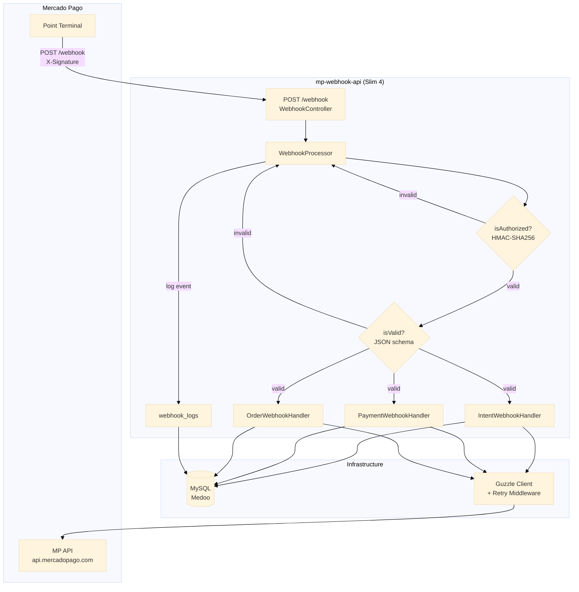
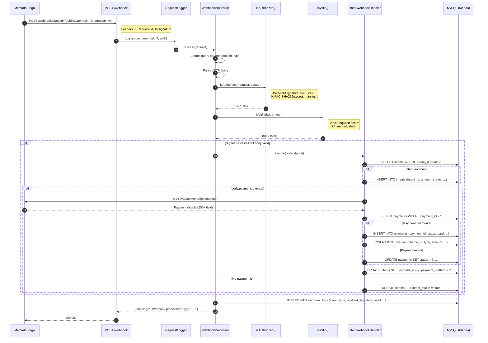
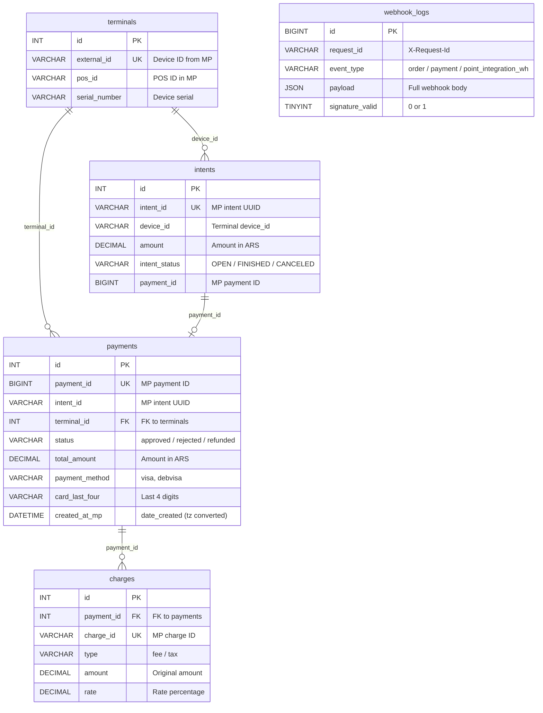

# mp-webhook-api

Mercado Pago webhook processor built with Slim 4. It receives, validates, logs, and stores payment notifications from in-person _Point Smart_ terminals, and is also compatible with static QR payments. Designed as the bridge between MP and the POS software of a physical store.

To understand this project, it is strongly recommended to review the Mercado Pago documentation:
https://www.mercadopago.com.ar/developers/es/docs/mp-point/overview

> **Note:** This project is an AI-assisted refactor based on real-world development on the legacy MP API, supervised by me. See [PLAN.md](./docs/PLAN.md) for the implementation decisions.

## Installation

### Prerequisites

- PHP 8.3+ with `pdo_mysql`, `json`, `mbstring`, `openssl` extensions
- MariaDB 10.6+ or MySQL 8.0+ (for `json` column compatibility, otherwise adjust the `webhook_logs` table)
- Composer 2.x

### Steps

```bash
git clone https://github.com/Arian023/mp-webhook-api.git
cd mp-webhook-api
composer install
cp .env.example .env
```

Edit `.env` with your credentials:

```env
DB_HOST=localhost
DB_PORT=3306
DB_NAME=mp_webhook
DB_USER=root
DB_PASS=

MP_ACCESS_TOKEN=APP_USR-...
MP_WEBHOOK_SECRET=your-webhook-secret
```

## Tech Stack

- [**PHP**](https://www.php.net/) 8.3 or higher
- [**Slim 4**](https://www.slimframework.com/) — PSR-7/15 micro framework
- [**PHP-DI**](https://php-di.org/doc/frameworks/slim.html) — Dependency injection container
- [**Medoo**](https://medoo.in/) — Lightweight PDO-based database abstraction
- [**Guzzle 7**](https://docs.guzzlephp.org/en/stable/index.html) — HTTP client with retry middleware
- [**Monolog 3**](https://seldaek.github.io/monolog/) — Logging to files, console, or database
- [**Phinx**](https://phinx.org/) — Database migrations
- [**Carbon**](https://carbon.nesbot.com/) — Date/time handling

## Development

This project includes configuration for [Lerd](https://lerd.sh). Get started with:

```bash
lerd link          # Register site at mp-webhook-api.test
lerd start         # Start PHP-FPM, MariaDB, Nginx
```

MariaDB is available at `lerd-mariadb-11-8:3306` from the containers (user: `root`, password: `lerd`).

Alternatively, you can use [php.new](https://php.new/) or [Laravel Herd](https://herd.laravel.com/) on Windows / macOS to run the project quickly.

```bash
# Code style (Pint)
composer lint

# Static analysis (PHPStan level 5)
composer analyse

# Both
composer test
```

### Database

```bash
# Create the database
mysql -u root -p -e "CREATE DATABASE mp_webhook CHARACTER SET utf8mb4;"

# Run migrations
vendor/bin/phinx migrate
```

---


## Architecture

This diagram represents the processing flow of a received webhook notification, from intake to storage in the database. A webhook only provides the minimum data of an intent, payment, or order. To obtain the full information, calls are made to the Mercado Pago API.



### Layers

| Layer | Path | Description |
|---|---|---|
| HTTP | `app/Http/Controllers/` | Slim route handlers |
| Middleware | `app/Http/Middleware/` | Auth, logging, error handling |
| Application | `app/Application/Services/` | Business logic orchestration |
| Infrastructure | `app/Infrastructure/` | Database, MP API client, repositories |

---

## API Endpoints

### Webhook (no auth — signature validated)

```
POST /webhook?data.id={uuid}&type=point_integration_wh
```

Headers: `X-Request-Id`, `X-Signature: ts=...,v1=...`

### Intent Management (Bearer auth)

| Method | Endpoint | Description |
|---|---|---|
| `POST` | `/api/intents?device_id={id}` | Create payment intent |
| `GET` | `/api/intents/{id}` | Get intent status |
| `DELETE` | `/api/intents/{id}/cancel?device_id={id}` | Cancel intent |
| `POST` | `/api/intents/{id}/refund` | Refund intent's payment |

### Payment Management (Bearer auth)

| Method | Endpoint | Description |
|---|---|---|
| `GET` | `/api/payments/{id}` | Get payment details |
| `POST` | `/api/payments/{id}/refund` | Refund payment |

### Orders API (Bearer auth)

| Method | Endpoint | Description |
|---|---|---|
| `POST` | `/api/orders` | Create order (Orders API) |
| `GET` | `/api/orders/{id}` | Get order details |
| `POST` | `/api/orders/{id}/cancel` | Cancel order |
| `POST` | `/api/orders/{id}/refund` | Refund order |

### Health (no auth)

```
GET /health
```

Returns `{"status":"ok","database":"connected"}`.

### API Examples

See `docs/examples/` for anonymized JSON responses from the Mercado Pago API. Useful as reference for webhook and payment structures.

## Webhook Flow

### `point_integration_wh` (intent notification)

Received when a Point terminal creates, completes, or cancels a payment intent.



```json
// Query: ?data.id=61ec4adf-...&type=point_integration_wh
// Body (state=FINISHED, has payment):
{
  "additional_info": {"external_reference": "000910854661-000910029286"},
  "amount": 3980000,
  "created_at": "2026-06-28 20:39:45",
  "id": "61ec4adf-82b3-414e-beb7-0308f131c63b",
  "payment": {"id": 165404232933, "state": "approved", "type": "credit_card"},
  "state": "FINISHED"
}
```

**Key**: `amount` is in **cents** (divide by 100 for ARS).

Processing steps:
1. Validate HMAC-SHA256 signature
2. Find or create intent in `intents` table
3. If `payment.id` exists → fetch full payment from `GET /v1/payments/{id}`
4. Insert payment + charges into DB
5. Link intent to payment
6. Log event to `webhook_logs`

### `payment` (legacy API)

Direct payment notification. Fetches payment details and stores them.

### `order` (current API)

Order status notification. Receives order events like `order.created`, `order.updated`, `order.canceled`. Fetches the full order from MP API, stores/updates it in the local DB, and syncs the associated payments.

### Optional notifications

Other [optional cases](https://www.mercadopago.com.ar/developers/es/docs/mp-point/optional-notifications), such as Application Linking (`mp-connect`), Claims (`topic_claims_integration_wh`), and Chargebacks (`topic_chargebacks_wh`), are recorded in `webhook_logs` and responded to with HTTP 200 but are not processed. They are out of the project's scope and depend on their use in a CRM or payment system.

## Database Schema

Six tables managed by Phinx migrations:

| Table | Description |
|---|---|
| `terminals` | Registered Point devices (external_id, pos_id, branch) |
| `intents` | Payment intents (intent_id UUID, amount, status, linked payment) |
| `payments` | Payment records (payment_id, card details, amounts, timestamps) |
| `charges` | Fee and tax breakdown per payment |
| `orders` | Orders API records (order_id, status, device_id, payment details) |
| `webhook_logs` | Full webhook event log (payload, signature, response code) |



## Project Structure

```
mp-webhook-api/
├── app/
│   ├── Application/Services/        # WebhookProcessor, handlers, IntentService, PaymentService
│   ├── Http/
│   │   ├── Controllers/             # Webhook, Intent, Payment, Health
│   │   └── Middleware/              # BearerAuth, RequestLogger, ErrorHandler
│   └── Infrastructure/
│       ├── Database.php             # Medoo factory
│       ├── Helpers/DateHelper.php   # Timezone conversion
│       ├── MercadoPago/             # Guzzle client + exception
│       └── Repositories/            # Terminal, Intent, Payment, WebhookLog
├── bootstrap/                       # Container, middleware, routes
├── database/migrations/             # Phinx migrations
├── docs/examples/                   # API response examples
├── public/index.php                 # Front controller
├── phinx.php                        # Phinx config
├── pint.json                        # Laravel Pint config
├── rector.php                       # Rector config
└── phpstan.neon.dist                # PHPStan config
```

## License

This project is released under the [MIT License](https://opensource.org/license/MIT).
